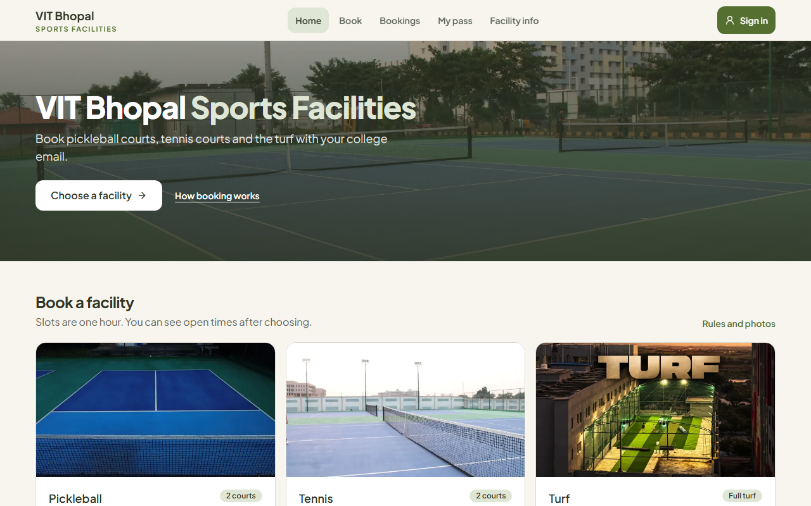
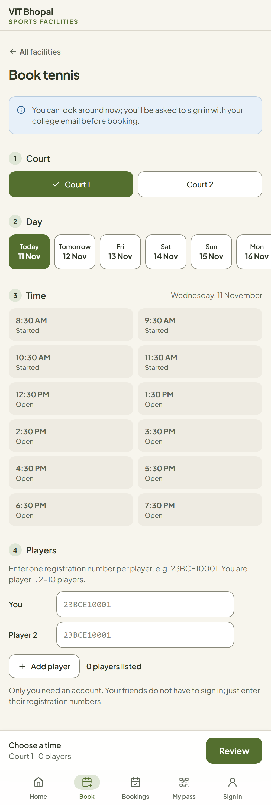
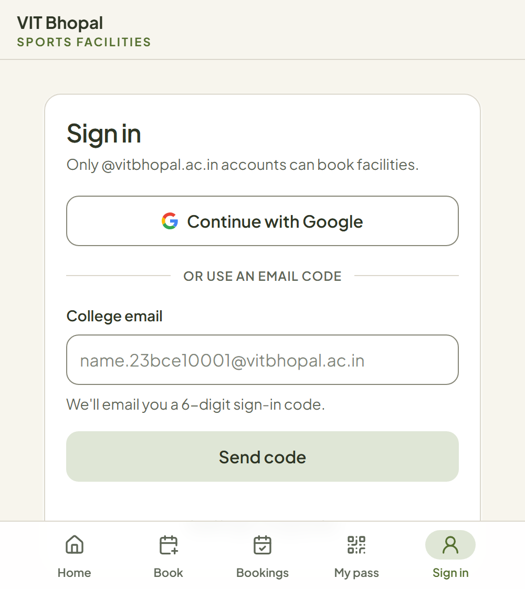
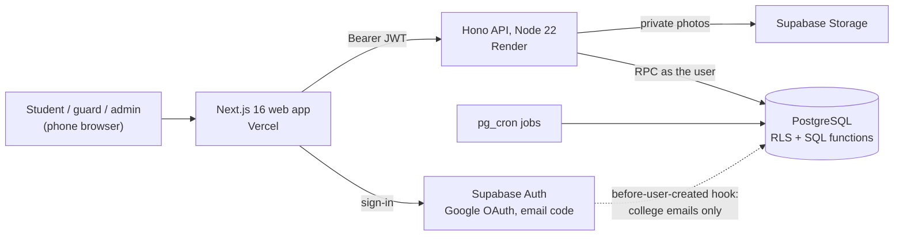

# VIT Bhopal Sports Facilities

A booking portal for VIT Bhopal's pickleball courts, tennis courts and turf. Students book a slot with their college account, show a QR pass at the gate, and the guard scans it to check the group in. The sports office runs everything from a dashboard.

**Live:** [vit-bhopal-sports-facilities-ia3m.vercel.app](https://vit-bhopal-sports-facilities-ia3m.vercel.app)




<p align="center">
  
  &nbsp;&nbsp;
  
</p>

## What it does

**Students**
- Sign in with their `@vitbhopal.ac.in` Google account or a 6-digit email code. No other email domain can create an account.
- Pick a court, day and one-hour slot, and list every player by registration number, one box per player.
- Get a QR pass for each booking, and cancel for free until an hour before the start.
- Join a waiting list for a full slot. If it is cancelled, the first student in line gets a 10-minute offer.
- Check out after playing and rate the session, or report a problem with a photo.

**Guards**
- Sign in with a staff username and password, and see only the scanner.
- Scan a pass to check the whole group in, from 10 minutes before the start to 15 minutes after. They see the facility, time, booker and every player's registration number. Too early, too late, wrong day and cancelled passes each get a clear message.

**Sports office**
- Usage analytics: bookings and check-ins per day, facility and time slot.
- All bookings, with admin cancellation and a reason the student sees.
- Maintenance and event blocks, with a preview of the bookings they would affect.
- Feedback and issue reports with photos, tracked to resolution.
- Staff roles (guards and admins), and the status of background jobs.

**Rules the system enforces on its own**
- One booking per sport per day, and one turf booking per week.
- Turf weeks open every Friday at 12:00 IST.
- A slot nobody checks in to within 15 minutes is released to other students.

## Architecture



The **database is the source of truth.** Every booking rule lives in PostgreSQL functions, and the API calls them as the signed-in user. So the rules hold even if a request skips the website or the API.

## Engineering highlights

**Correct under concurrency**
- Two students can never book the same slot. Partial unique indexes back every limit.
- A per-slot advisory lock serialises booking, cancellation and waiting-list offers for that slot.
- Every booking request carries an idempotency key, so a retry on a flaky mobile connection returns the original booking instead of making a second one.

**Security**
- Row-level security on all 16 tables. Apart from a student's own name and registration number, clients cannot write any table directly: bookings, passes, roles and check-ins change only through `SECURITY DEFINER` functions that check the caller.
- Sign-up is limited to college emails by a Supabase Auth hook, and a student's registration number must match the one in their college email.
- Guard accounts are locked to check-in only, enforced in the database as well as the UI.
- The API verifies JWTs against Supabase's public ES256 keys, allows only exact CORS origins, validates every body with Zod, and rate-limits per user and per IP.
- The website sends a strict Content-Security-Policy, HSTS and other security headers. No secrets reach the browser.
- QR passes carry only a random, unguessable token: no name, email or booking ID. Issue photos sit in a private bucket; their type is checked from the file's bytes and they are shown only through short-lived signed URLs.

**Time and background work**
- All dates and times are in IST. The Friday turf release is calculated rather than scheduled, so it cannot be missed or run twice.
- `pg_cron` jobs inside Postgres release no-shows, expire waiting-list offers and apply data retention every minute or hour. Each job is idempotent.
- A `/health/jobs` endpoint lets an uptime monitor alert when a job stops running.

**Privacy**
- Old booking data is deleted after its retention period and kept only as anonymous daily counts.
- A public [privacy policy](https://vit-bhopal-sports-facilities-ia3m.vercel.app/privacy) explains what is stored and who can see it.

**Testing:** 239 automated tests.
- The database suite applies every migration to an in-memory Postgres (PGlite) and attacks the policies as anonymous, student, guard and admin users. No Docker is needed.
- API integration tests run the real API against the same database.

## Tech stack

| Layer | Tools |
|---|---|
| Frontend | Next.js 16 (App Router, Turbopack), React 19, TypeScript, Tailwind CSS, Radix UI, Recharts, jsQR |
| API | Hono on Node.js 22, Zod, jose (JWT), esbuild |
| Database and auth | Supabase: PostgreSQL with RLS, SQL functions, pg_cron, Auth (Google OAuth, email OTP, password for staff), Storage |
| Shared code | `packages/shared`: slot times, facility rules, IST helpers, request schemas and error codes, used by both the web app and the API |
| Testing | Vitest, PGlite |
| Hosting | Vercel (web), Render (API), Supabase (database) |

## Repository layout

```
apps/web         Next.js frontend: student, guard and sports-office screens
apps/api         Hono API: auth, validation, rate limits, photo uploads
packages/shared  Code shared by both apps: slots, facility rules, IST time, schemas, error codes
supabase/        SQL migrations, database tests, local CLI config, email template
docs/            Decisions, deployment, environment, roles, operations, design system
```

## Running it locally

Requires Node.js 22+.

```bash
npm install
```

To try the booking screens without a Supabase project, start the demo API. It runs an in-memory Postgres with every migration and a few fake bookings.

```bash
npm run dev:local -w @vitb/api
```

Then start the web app pointed at it:

```bash
NEXT_PUBLIC_API_URL=http://localhost:8787 npm run dev:web
```

Signing in needs a real Supabase project:
1. Copy `apps/web/.env.example` to `apps/web/.env.local`, and `apps/api/.env.example` to `apps/api/.env`.
2. Fill in your project's values; see [docs/ENVIRONMENT.md](docs/ENVIRONMENT.md).
3. Run `npm run dev:web` and `npm run dev:api`.

## Checks

```bash
npm run check
```

This runs the type checks, ESLint, and every test suite: shared, API, web and database.

## Documentation

- [Product and engineering decisions](docs/DECISIONS.md)
- [Deployment](docs/DEPLOYMENT.md)
- [Environment variables and Supabase settings](docs/ENVIRONMENT.md)
- [Roles and admin bootstrap](docs/ROLES.md)
- [Operations runbook: jobs, monitoring, retention](docs/OPERATIONS.md)
- [Design system](docs/DESIGN_SYSTEM.md)
- [Original audit and build plan](docs/PHASE1_AUDIT.md)

## Author

Designed and built by **Abhilash Shah** ([@shahabhilash](https://github.com/shahabhilash)).

All rights reserved. The code is public to read, but it is not licensed for reuse.
